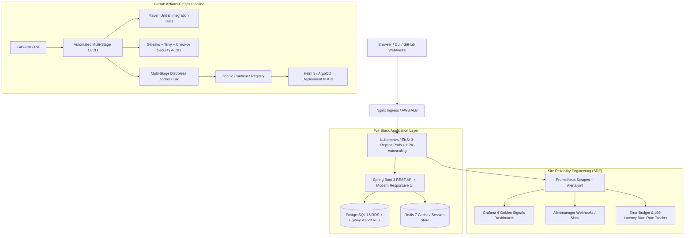

# InfraPilot — Production DevSecOps, Cloud & SRE Enterprise Platform
[](https://github.com/Chaitanya5068/InfraPilot/actions)
[](https://github.com/Chaitanya5068/InfraPilot/actions)
[](security/)
[](k8s/)
[](monitoring/)

An enterprise-grade **Cloud, DevOps, and SRE Platform** built with **Full-Stack Spring Boot / JavaScript, Terraform Infrastructure-as-Code, Kubernetes / Helm, GitHub Actions CI/CD, and SRE Observability**.

Designed to showcase real-world production engineering competencies across **Infrastructure Automation, Security Scanning, Container Orchestration, and System Reliability**.

---

## 🎯 Architecture & Engineering Stack



---

## 🛠️ Key Competencies & Implemented Features

### 1. ☸️ Kubernetes & Container Orchestration (`/k8s` & `/helm`)
- **Zero-Downtime Rolling Updates**: Configured `maxSurge: 1, maxUnavailable: 0` for seamless deployments.
- **Horizontal Pod Autoscaling (HPA)**: Dynamic auto-scaling between 3 and 10 replicas triggered at 70% CPU / 80% Memory thresholds with scale-down stabilization windows.
- **High Availability Pod Anti-Affinity**: Ensures replicas are spread across distinct Kubernetes worker nodes.
- **Liveness & Readiness Probes**: Automated health checks pinging `/api/v1/health` with failure thresholds.
- **Modular Helm Chart**: Environment-specific configurations (`values.yaml` for Dev, `values-prod.yaml` for Production).

### 2. 🚀 Automated CI/CD Pipelines (`.github/workflows`)
- **`ci-cd-pipeline.yml`**:
  - Multi-stage parallelized workflow: Build & Test &rarr; DevSecOps Security Audit &rarr; Docker Build & Push &rarr; GitOps Deployment.
  - Automated security report upload (SARIF) to GitHub Security Center.
- **`terraform-ci.yml`**:
  - Automated `terraform fmt -check`, `tflint`, and `checkov` static analysis for cloud infrastructure modules before merge.

### 3. 🛡️ DevSecOps & Security Hardening
- **Secrets Detection**: Gitleaks prevents secret leakage in git history.
- **Vulnerability Scanning**: Trivy scans container base images and filesystem dependencies.
- **IaC Compliance**: Checkov validates AWS CIS Benchmarks across Terraform modules.
- **Container Hardening**: Multi-stage Dockerfile running as non-root user `10001:10001` with minimal attack surface.

### 4. 📊 Site Reliability Engineering (SRE) & Observability (`/monitoring`)
- **The 4 Golden Signals**: Latency, Traffic, Errors, and Saturation tracked via Prometheus & Grafana.
- **SLI / SLO Alerting (`monitoring/prometheus/alerts.yml`)**:
  - `HighErrorRateBurn`: Alerts when API 5xx errors consume > 1% of error budget in 5 minutes.
  - `ApiLatencyP99Breach`: Alerts when p99 latency exceeds 250ms SLA.
  - `KubernetesPodCrashLooping`: Detects flapping pods in production namespace.
  - `DatabasePoolExhaustion`: Warns when HikariCP connection pool reaches 85% capacity.

### 5. 💻 Full-Stack Multi-Tenant Application
- **Modern Responsive Dashboard**: Interactive management of Cloud deployments, active pipelines, security scan findings, and developer activity monitoring.
- **PostgreSQL Row-Level Security (RLS)**: Enforced isolation across independent tenant organizations and root administrators.
- **Dual Independent Port Architecture**:
  - Main Platform: `http://localhost:8080/`
  - Zero-Blast-Radius Admin Portal: `http://localhost:8085/`

---

## ⚡ Quick Start Guide

### Run Locally with Docker Compose
```bash
# 1. Clone repository
git clone https://github.com/Chaitanya5068/InfraPilot.git
cd InfraPilot

# 2. Start PostgreSQL, Redis, Prometheus, and Grafana
docker compose up -d

# 3. Start InfraPilot Main Application
node scripts/serve.js
# Access Main Platform: http://localhost:8080/

# 4. Start Independent Admin Node
node scripts/serve-admin.js
# Access Admin Portal: http://localhost:8085/
```

### Dry-Run Kubernetes Deployment with Helm
```bash
# Validate and generate Kubernetes production manifests
helm lint helm/infrapilot/
helm template infrapilot-prod helm/infrapilot/ -f helm/infrapilot/values-prod.yaml
```

---

## 👨‍💻 Author & Contact
- **Engineer**: Chaitanya
- **Role**: Cloud / DevOps / SRE Engineer
- **GitHub**: [@Chaitanya5068](https://github.com/Chaitanya5068)
- **Repository**: [https://github.com/Chaitanya5068/InfraPilot](https://github.com/Chaitanya5068/InfraPilot)
